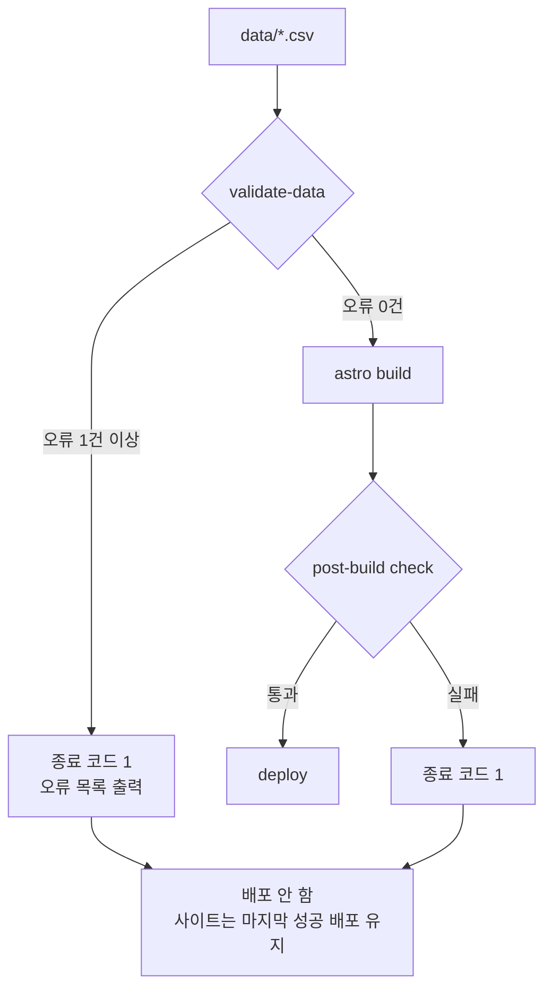

# 데이터 검증 규칙 — 배포 전 빌드 게이트

- 상태: 제안됨 · 작성일: 2026-11-20 · 근거: [PRD v0.6](../prd/PRD-v0.6.md) §5, §6, §7, §8, §9, §10, §13
- 관련: [ADR-0002](../adr/0002-four-sheet-data-model-and-csv-build.md) (시트 4개·CSV 빌드), [ADR-0003](../adr/0003-coordinates-from-osm-not-google.md) (좌표), [tech-stack.md](tech-stack.md) §5

**현행 (2026-11-27):** `scripts/validate-data.ts`가 §4.1–§4.8의 **오류(E) 규칙**을 구현했다([계획 01](../plans/01-skeleton.md)). 경고(W) 규칙, §4.9 빌드 후 확인, `astro check`는 아직 없다. 이 문서는 그 나머지까지 포함한 **명세**다.

## 1. 목적

창업자는 시트를 고친 뒤 다시 배포한다(F5). 그런데 시트에는 형식 강제가 없다. 오타 하나로도 다음과 같은 일이 생길 수 있다(CTO v0.5 리뷰 지적 3).
- 상세 페이지가 깨진다.
- 카페가 필터에서 조용히 사라진다.
- 비공개 메모가 공개된다.

그래서 **모든 배포 전에** 아래 규칙을 확인하고, 오류가 있으면 배포하지 않는다.

## 2. 언제, 무엇이 실패하나



| 실행 위치 | 명령 (제안) | 실패 시 |
|---|---|---|
| 로컬 | `npm run validate` / `npm run build`(빌드 전에 검증을 먼저 실행) | 터미널에 오류 목록. 빌드 안 됨 |
| PR (`ci.yml`) | 검증 → 빌드 → 빌드 후 확인 | PR 체크 실패. 필수 체크로 지정하면 머지가 막힌다 |
| main / 수동 (`deploy.yml`) | 같은 단계 + 배포 | 배포 단계가 실행되지 않는다. **라이브 사이트는 이전 상태 그대로** |

**심각도**
- **E (오류)**: 빌드를 멈춘다. 종료 코드 1.
- **W (경고)**: 출력만 하고 빌드는 계속한다. GitHub Actions 작업 요약(job summary)에도 남긴다.
- `--strict` 옵션을 주면 W도 E로 처리한다. 공개 출시(M2) 전 점검용으로 제안한다.

**출력 형식**: 첫 오류에서 멈추지 않고 모든 문제를 모아 한 번에 보여 준다. 한 줄에 하나씩, 시트 이름 · **시트의 행 번호**(헤더 = 1행) · 열 · 값 · 규칙 ID · 메시지를 적는다. 예:

```
E  V-M06  methods!14  source_url  ""  source_url is required unless source_type is "visit"
W  V-CA11 cafes!9     lat,lng     35.70,139.80  1,820 m from nearest station "shibuya" (> 1,500 m)
```

검증 스크립트는 **시트나 CSV를 고치지 않는다.** 수정은 언제나 시트에서 하고 다시 받는다(ADR-0002).

## 3. 파싱 규칙 (모든 규칙의 전제)

- 인코딩은 UTF-8이다. 맨 앞의 BOM은 제거한다. 첫 행이 헤더다.
- 셀 값의 앞뒤 공백은 잘라 낸다. 잘라 낸 뒤 빈 문자열이면 "비어 있음"으로 본다.
- 모든 셀이 빈 행은 무시한다.
- 숫자(`lat`, `lng`)는 반각 숫자와 `.` 소수점만 허용한다. 쉼표 소수점과 전각 숫자는 오류다.
- 코드 값(`method`, `status` 등)은 대소문자를 구분한다. 정확히 일치해야 한다.

## 4. 규칙

### 4.1 파일과 열

| ID | 심각도 | 규칙 | 근거 |
|---|---|---|---|
| V-F01 | E | `data/cafes.csv`, `chains.csv`, `methods.csv`, `stations.csv` 4개가 있고 CSV로 파싱된다(모든 행의 열 수가 헤더와 같음) | §9 |
| V-F02 | E | 각 시트에 §9의 열이 모두 있다. 열 이름은 정확히 일치해야 한다 | §9 |
| V-F03 | W | §9에 없는 열이 있다. 빌드는 그 열을 읽지 않고 출력하지도 않는다 | §9 |
| ~~V-F04~~ | — | 삭제(2026-11-27). `internal_note`는 공개돼도 괜찮다고 결정했다(ADR-0002). 사이트에 보여 주지 않을 뿐 검사하지 않는다 | — |
| V-F05 | E | `stations`에 1행 이상, `cafes`에 1행 이상 있다 | §7 SC-01·SC-02 |

### 4.2 공통 형식

| ID | 심각도 | 규칙 | 근거 |
|---|---|---|---|
| V-C01 | E | 각 시트의 `id`는 비어 있지 않고, 시트 안에서 유일하며, `^[a-z0-9]+(-[a-z0-9]+)*$` 형식이다(URL slug) | §7 경로, §9 |
| V-C02 | E | 날짜 열(`checked_at`)은 `YYYY-MM-DD` 형식의 실제 날짜이며, 빌드일(JST) 기준 미래가 아니다 | §6, §9 |
| V-C03 | E | URL 열(`cafe_url`, `social_url`, `site_url`, `source_url`, `source_url_2`)은 값이 있으면 `http://` 또는 `https://`로 시작하는 절대 URL이다 | §6, §8 F3 |
| V-C04 | W | URL이 `http://`다(`https://` 권장) | — |
| V-C05 | E | 좌표(`lat`, `lng`)는 둘 다 있고 숫자이며, 일본 범위(위도 20~46, 경도 122~154) 안이다. 위도·경도를 바꿔 쓴 실수를 잡는다 | F1, §9 |

### 4.3 `cafes`

| ID | 심각도 | 규칙 | 근거 |
|---|---|---|---|
| V-CA01 | E | `name_en`과 `name_ja`가 **둘 다** 있다 (결정 2026-11-27) | §9, §10 |
| V-CA02 | E | `address_en`, `address_ja` 중 하나 이상 있다 | §9 |
| V-CA03 | E | `coord_source`는 `osm` 또는 `geocoded`다 | §9, ADR-0003 |
| V-CA04 | W | `coord_source = osm`인데 `osm_id`가 비어 있다 | ADR-0003 |
| V-CA05 | E | `osm_id`가 있으면 `^(node\|way\|relation)/[0-9]+$` 형식이다 | ADR-0003 |
| V-CA06 | E | `status`는 `active`, `closed`, `moved` 중 하나다 | §9 |
| V-CA07 | E | `status = moved`면 `moved_to`가 있고, `cafes.id`에 존재하며, 자기 자신이 아니다 | §9, F3 |
| V-CA08 | E | `status`가 `moved`가 아니면 `moved_to`는 비어 있다 | §9 |
| V-CA09 | E | `moved_to`를 따라가면 순환 없이 `active` 또는 `closed` 카페에서 끝난다 | F3 |
| V-CA10 | E | `chain_id`가 있으면 `chains.id`에 존재한다 | §9 |
| V-CA11 | W | 빌드가 계산한 가장 가까운 역까지 1,500 m를 넘는다. 좌표가 틀렸거나 대상 지역 밖일 수 있다 | F8 반경 1.5 km, §13 |
| V-CA12 | E | 시트의 `station_id`가 비어 있지 않으면 `stations.id`에 존재한다 | §9 |
| V-CA13 | W | 시트의 `station_id`가 빌드가 계산한 가장 가까운 역과 다르다. **빌드는 계산값을 쓴다** | §9 "computed at build", F1 |
| V-CA14 | W | 서로 다른 두 카페의 좌표가 완전히 같다. 중복 행일 수 있다 | — |

### 4.4 `chains`

| ID | 심각도 | 규칙 | 근거 |
|---|---|---|---|
| V-CH01 | E | `name_en`과 `name_ja`가 **둘 다** 있다 (결정 2026-11-27) | §9, F9 |
| ~~V-CH02~~ | — | 삭제(2026-11-27). V-CH01이 두 이름을 모두 요구한다 | — |
| V-CH03 | E | `site_url`이 있다 | F9 "official website" |
| V-CH04 | W | `note_en` 또는 `note_ja`가 비어 있다 | F9 |
| V-CH05 | E | `checked_at`이 있다(형식은 V-C02) | §9 |
| V-CH06 | W | 이 체인에 속한 `active` 매장이 `cafes`에 하나도 없다. v1 범위는 런치 지역에 매장이 있는 체인이다 | F9 Scope, G3 |

### 4.5 `methods`

| ID | 심각도 | 규칙 | 근거 |
|---|---|---|---|
| V-M01 | E | `cafe_id`와 `chain_id` 중 **정확히 하나**만 값이 있다(XOR) | §9 |
| V-M02 | E | `cafe_id`는 `cafes.id`에, `chain_id`는 `chains.id`에 존재한다 | §9 |
| V-M03 | E | `cafe_id`가 가리키는 카페의 `chain_id`는 비어 있다. **체인 매장은 자기 방식 행을 가질 수 없다** | §5, §9, F3, §19 #4 |
| V-M04 | E | `method`는 §5의 코드 9개 중 하나다: `espresso_semi`, `espresso_auto`, `espresso_none`, `hand_drip`, `siphon`, `french_press`, `aeropress`, `batch_brew`, `premade` | §5 |
| V-M05 | E | `source_type`은 §6의 코드 5개 중 하나다: `cafe_site`, `cafe_social`, `owner`, `visit`, `third_party` | §6 |
| V-M06 | E | `source_type`이 `visit`가 아니면 `source_url`이 있다. `visit`이면 비어 있어도 된다 | §6, §9 |
| V-M07 | W | `source_url_2`는 있는데 `source_url`이 비어 있다 | §9 |
| V-M08 | E | `checked_at`이 있다(형식은 V-C02) | §6, §9 |
| V-M09 | E | 같은 대상(카페 또는 체인)에 같은 `method`가 두 번 이상 나온다 | §5 |
| V-M10 | W | `checked_at`이 빌드일 기준 12개월보다 오래됐다. 페이지에 "Checked over a year ago"가 표시된다. 재확인 후보 목록으로 출력한다 | §6, §12 정확도 재확인 |

### 4.6 에스프레소 상태 (시트 간 규칙)

PRD는 "모든 카페는 에스프레소 상태를 가진다"(§5)고 하면서, 동시에 "반자동과 전자동 머신을 모두 가진 카페는 'Hand-made espresso only'를 통과한다"(F2)고도 한다. 그래서 **에스프레소 상태를 다음 둘 중 정확히 하나**로 본다. 이 해석은 창업자가 승인했다(2026-11-27): 둘 다 가진 카페는 둘 다 기록한다.
- **머신 있음**: `espresso_semi`, `espresso_auto` 중 하나 이상(둘 다 가능)
- **머신 없음**: `espresso_none`만

| ID | 심각도 | 규칙 | 근거 |
|---|---|---|---|
| V-E01 | E | `status = active`이고 `chain_id`가 빈 **독립 카페**마다 에스프레소 그룹 행(`espresso_semi`, `espresso_auto`, `espresso_none`)이 1개 이상 있다 | §5, G2 |
| V-E02 | E | 같은 대상에 `espresso_none`과 `espresso_semi`/`espresso_auto`가 함께 있으면 안 된다 | §5 |
| V-E03 | E | **모든 체인**에 V-E01, V-E02와 같은 에스프레소 상태가 있다. 체인 매장은 이것을 자기 상태로 쓰고, SC-06 목록도 이것을 보여 준다 | §5, F9 |
| V-E04 | — | `closed`, `moved` 카페는 에스프레소 행이 없어도 된다. 있으면 "마지막으로 알려진 데이터"로 흐리게 보여 준다 | F3 |

### 4.7 `stations`

| ID | 심각도 | 규칙 | 근거 |
|---|---|---|---|
| V-S01 | E | `name_en`과 `name_ja`가 **둘 다** 있다. SC-02는 두 이름을 함께 보여 준다 | §7 SC-02, §9 |
| V-S02 | E | `lat`, `lng`가 V-C05를 통과한다 | §9 |
| V-S03 | E | `source`가 있다 | §9, ADR-0003 |
| V-S04 | W | 이 역에 배정된 `active` 독립 카페가 8곳 미만이다. 런치 목표는 역마다 8곳 이상이다. M0와 M1을 병행하는 동안에는 경고로만 둔다 | §13 |

### 4.8 번역 문자열

| ID | 심각도 | 규칙 | 근거 |
|---|---|---|---|
| V-T01 | E | 문자열 파일의 모든 키에 `en`과 `ja` 값이 둘 다 있다 | §10 Translations |
| V-T02 | E | §5 방식 코드 9개, §6 출처 코드 5개, 상태(`closed`, `moved`) 각각에 EN/JA 라벨이 있다 | §5, §6, F3 |

### 4.9 빌드 후 확인 (`dist/` 대상)

| ID | 심각도 | 규칙 | 근거 |
|---|---|---|---|
| V-B01 | W | 사이트 페이지(`dist/`의 HTML)에 `internal_note` 값이 보이지 않는다. 공개 CSV에는 있어도 되지만, 화면에 보여 주지는 않는다 | §9 |
| V-B02 | E | `cafes`의 모든 id(`closed`, `moved` 포함)에 대해 `/en/cafe/{id}/`와 `/ja/cafe/{id}/` 페이지가 있다. 모든 체인 id에 대해 `/{lang}/chains/{id}/`가 있다 | F3 "URL still works", F9 |
| V-B03 | E | 모든 HTML에 비어 있지 않은 `<title>`이 있다. `/en/…` 아래 페이지는 `<html lang="en">`, `/ja/…` 아래 페이지는 `<html lang="ja">`다 | §10 |
| V-B04 | E | `404.html`, 언어별 오프라인 페이지, `manifest.webmanifest`, `sw.js`가 있다 | §7, §11 |

## 5. 요약 출력

검증이 끝나면 오류·경고와 함께 다음 수치를 출력한다. 진척 확인용이며 실패 조건은 아니다.
- 역별 `active` 독립 카페 수, 체인 매장 수 (§13: 역마다 8곳 이상, 합계 25~30곳)
- 체인 수와 매장이 있는 체인 수 (G3)
- 에스프레소 상태별 독립 카페 수 (§14 test 2와 같은 분류: 반자동 / 전자동 / 없음)
- 12개월 넘은 방식 행 수 (V-M10)

## 6. 범위 밖

- 링크가 실제로 살아 있는지(HTTP 요청)는 확인하지 않는다. 빌드가 외부 사이트에 의존하게 되기 때문이다. 필요하면 월 1회 수동으로 확인한다(§12 정확도 재확인과 함께).
- 출처가 정말 그 사실을 뒷받침하는지는 사람이 판단한다.
- 체인 정의(일본 내 5개 매장 이상, §5)는 시트에 근거 열이 없어 기계로 확인할 수 없다.

## 7. 열린 질문

- ~~**Q1.**~~ 결정(2026-11-27): 위 해석대로 둔다. 반자동과 전자동을 둘 다 가진 카페는 둘 다 기록한다.
- **Q2.** `cafes.station_id` 열을 시트에 둘 것인가? PRD는 "빌드 때 계산"이라고 하면서 시트 열로도 적었다. 이 문서는 계산값을 정본으로 하고, 시트 값은 다르면 경고만 하도록 했다(V-CA13). 열을 없애면 V-CA12와 V-CA13은 필요 없다.
- ~~**Q3.**~~ 결정(2026-11-27): `internal_note`는 공개돼도 괜찮다. V-F04는 삭제, V-B01은 경고로 낮췄다.
- ~~**Q4.**~~ 결정(2026-11-27): 카페·체인·역 모두 영어·일본어 이름이 둘 다 필수다.
- **Q5.** 공개 출시(M2) 전 `--strict`(경고도 실패)를 필수로 할 것인가?
- **Q6.** PR 검증을 머지 필수 체크로 지정할 것인가(GitHub 브랜치 보호 설정)?
