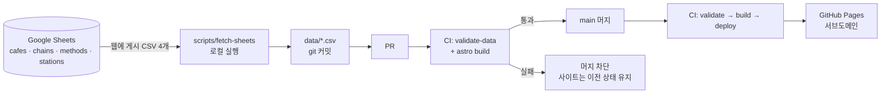

# 기술 스택 선정서 — 정적 사이트 생성기와 빌드 구성

- 상태: 제안됨 · 작성일: 2026-11-20 · 근거 문서: [PRD v0.6](../prd/PRD-v0.6.md)
- 웹 사실 확인일: **2026-11-20** (버전·가격·한도는 이 날짜 기준이며 바뀔 수 있다)
- 관련 ADR: [0001](../adr/0001-static-site-and-light-pwa.md) · [0002](../adr/0002-four-sheet-data-model-and-csv-build.md) · [0005](../adr/0005-static-site-generator-astro.md) · [0006](../adr/0006-hosting-github-pages.md)

## 0. 문서 범위와 방식

작은 1인 사이드 프로젝트라서 SAD는 쓰지 않는다. 이 문서는 **아직 열려 있는 기술 결정 하나(정적 사이트 생성기와 빌드 구성)** 와 거기에 딸린 두 결정(시트를 CSV로 가져오는 방법, 무료 정적 호스팅)만 다룬다. 나머지 결정은 PRD가 이미 내렸고, ADR 0001~0004에 기록한다.

PRD에는 `REQ-xx`/`FN-xx` 번호가 없다. 그래서 추적 근거로 PRD의 절(§), 화면(`SC-xx`), 기능(`F1`~`F9`), 목표(`G1`~`G3`) 번호를 쓴다.

**현행:** 코드, `package.json`, 빌드 설정이 하나도 없다. 레포에는 기획 문서뿐이다. 아래 내용은 모두 **제안**이다.

## 1. 결론 요약

| 결정 | 추천 | 한 줄 이유 |
|---|---|---|
| 정적 사이트 생성기 | **Astro** (정적 출력, UI 프레임워크 없음) | `/[lang]/…` 라우트와 CSV 로더가 기본 기능으로 되고, 기본 출력에 JS가 없으며, HTML을 알면 시작할 수 있다 |
| 클라이언트 JS | Astro `<script>` 안의 **순수 TypeScript** (React 등 쓰지 않음) | 거리 정렬, 필터, 공유 목록, F6 버튼 정도라 프레임워크가 필요 없다 |
| PWA | **직접 쓴 `sw.js`** (약 50줄, 네트워크 우선) + `manifest.webmanifest` | 플러그인 없이 동작을 전부 읽고 이해할 수 있다 |
| 시트 → CSV | **로컬 스크립트가 게시(publish)된 CSV 4개를 받아 `data/`에 커밋** → PR에서 검증 → main 머지 시 배포 | 수동 내보내기 4번이 필요 없고, 데이터 변경이 git diff로 남아 되돌릴 수 있다 |
| 빌드 게이트 | 배포 전 **데이터 검증 스크립트** ([data-validation.md](data-validation.md)) | 시트의 오타 하나가 깨진 페이지로 공개되는 것을 막는다 |
| 호스팅 | **GitHub Pages + GitHub Actions** | 레포가 이미 GitHub에 있고, 계정이 하나 늘지 않으며, 한도가 이 규모에 충분하다 |

## 2. PRD에서 나온 요구사항 (평가 기준의 근거)

| ID(이 문서용) | 요구 | PRD 근거 |
|---|---|---|
| K1 | 한 소스에서 `/en/…`, `/ja/…` 라우트를 모두 생성. 언어별 페이지 제목·설명. 루트 `/`는 마지막 선택 언어(localStorage) 또는 브라우저 언어로 이동 | §7, §10 |
| K2 | 빌드 시 CSV 4개(`cafes`, `chains`, `methods`, `stations`)로 페이지 생성: 카페마다 SC-03, 체인마다 SC-06 상세 | §9, §11, SC-03, SC-06 |
| K3 | 빌드 시 계산: 카페마다 가장 가까운 역 `station_id`, 역별 카페 수 | F1, SC-02, §9 |
| K4 | 기기에서 도는 작은 클라이언트 JS: 위치 권한·거리 정렬, 필터와 URL 상태(`?sort=`, `?st=`, `?f=`), 선택·공유 목록(`/list?c=`), F6 버튼과 localStorage | F1, F2, F7, F6, §10 |
| K5 | 가벼운 PWA: manifest + 네트워크 우선 service worker + 오프라인 화면 | §7 Offline, §11 |
| K6 | 무료 정적 호스팅, 개인 도메인의 서브도메인 | §11 |
| K7 | 학부생 1인이 배우고 유지하기 쉬울 것. 시간 예산 없음, 수익 없음 | §1, §15, §19 #5·#6 |
| K8 | 백엔드 없음. 위치 좌표는 기기를 떠나지 않음 | F1, §11 |

규모 추정(추정): 독립 카페 25~30곳 + 런치 지역 체인 매장(수십 곳 이내) + 체인 10~20개 + 역 3개. 언어 2개를 곱해도 정적 페이지는 수백 개 이하다. 빌드 성능은 어느 후보에서도 문제가 되지 않으므로 평가 기준에서 뺐다.

## 3. 후보

| 후보 | 개요 | 확인한 현재 상태 (2026-11-20) |
|---|---|---|
| **A. Astro** | HTML에 가까운 `.astro` 컴포넌트로 페이지를 만드는 정적 우선 프레임워크. 내부적으로 Vite 사용 | 최신 코어 `astro@7.4.13`(11월 18일 릴리스) [1]. 2026-01-16 Cloudflare가 Astro 팀(The Astro Technology Company)을 인수했고, MIT 라이선스와 오픈소스·호스팅 중립을 유지한다고 발표했다 [2] |
| **B. Eleventy (Build Awesome)** | 템플릿 언어(Nunjucks, Liquid 등)와 데이터 파일로 HTML을 만드는 단순한 생성기 | 안정 버전 v3.1.2. v4는 알파 진행 중. 2026-03-03 이름이 "Build Awesome"으로 바뀌었고, 오픈소스는 계속되며 유료 Pro는 필수가 아니라고 발표했다 [3] |
| **C. Vite + 직접 쓴 생성 스크립트** | Node 스크립트가 CSV를 읽어 템플릿 리터럴로 HTML 파일을 만들고, Vite가 JS·CSS를 번들 | Vite는 HTML 진입점을 하나씩 지정하는 멀티 페이지 빌드만 지원하고, 데이터로 HTML을 만들어 주지는 않는다 [4]. 라우팅·i18n·페이지 생성은 직접 짜야 한다 |
| **D. Hugo** | Go 단일 바이너리 생성기. 다국어가 기본 기능 | 최신 v0.170.1(2026-11-17) [5]. CSV는 `transform.Unmarshal`로 읽으며 기본은 행 배열(첫 행이 헤더), `map` 타깃이면 헤더 키 객체 [6]. 데이터로 페이지를 만드는 content adapter가 있고 언어별 실행을 지원한다 [7] |

검토에서 뺀 것:
- **단일 HTML 페이지(CTO v0.2 리뷰 제안)**: PRD v0.6은 카페·체인마다 고유 URL(SC-03, SC-06)과 언어별 페이지 제목(§10)을 요구하므로 맞지 않는다.
- **Next.js, SvelteKit 같은 앱 프레임워크**: 서버 렌더링이나 SPA 라우팅이 필요 없는 규모라 학습량만 늘어난다. 별도 조사는 하지 않았다.

## 4. 평가

가중치는 K7(혼자 배우고 유지)을 가장 무겁게 두었다. 점수(1~5)는 위 사실을 바탕으로 한 **판단**이며 측정값이 아니다.

| 기준 | 가중치 | A. Astro | B. Eleventy | C. Vite + 스크립트 | D. Hugo |
|---|---:|---:|---:|---:|---:|
| 학부생 1인의 학습·유지 용이성 (K7) | 25 | 4 | 3 | 3 | 2 |
| 한 소스로 `/en/`·`/ja/` 생성 (K1) | 15 | 5 | 4 | 2 | 5 |
| CSV 4개 → 빌드 시 페이지 생성·조인 (K2, K3) | 20 | 5 | 4 | 3 | 3 |
| 작은 클라이언트 JS와 그 번들링 (K4) | 15 | 5 | 3 | 5 | 4 |
| 가벼운 PWA 붙이기 (K5) | 5 | 4 | 4 | 4 | 4 |
| 무료 정적 호스팅 호환 (K6) | 5 | 5 | 5 | 5 | 5 |
| 지속성·업그레이드 부담 | 15 | 3 | 3 | 4 | 4 |
| **가중 합계 (/5)** | 100 | **4.40** | **3.45** | **3.45** | **3.50** |

### 점수 근거

**A. Astro**
- K7: 공식 문서는 "HTML을 쓸 수 있으면 Astro 컴포넌트를 쓸 수 있다"고 설명한다 [8]. 컴포넌트 문법은 HTML + 위쪽의 JS(TS) 영역이라 처음 배우는 개념이 적다. 대신 content collection, `getStaticPaths` 같은 Astro 고유 개념은 익혀야 한다.
- K1: `src/pages/[lang]/cafe/[id].astro`와 `getStaticPaths()`로 언어 × id 조합을 정적 생성할 수 있다. 내장 i18n 라우팅(`prefixDefaultLocale: true`면 모든 URL에 locale 접두사)과 `getRelativeLocaleUrl()` 같은 도우미도 있다 [9]. 다만 브라우저 언어 감지는 on-demand 렌더링에서만 동작한다 [9]. 그래서 루트 `/`의 언어 선택(§10)은 어느 후보든 클라이언트 스크립트로 해야 한다.
- K2: 내장 `file()` 로더에 `parser`를 넘기면 CSV를 컬렉션으로 읽을 수 있고, 문서에 `csv-parse` 예제가 있다 [10]. 컬렉션 스키마(zod)로 필드 형식 검증도 일부 할 수 있다 [10]. 단, 시트를 가로지르는 규칙은 별도 검증 스크립트가 맡는다([data-validation.md](data-validation.md)).
- K4: 기본적으로 클라이언트 JS를 적게 보내고, 클라이언트 렌더링은 필요할 때만 켜는 구조다 [8]. 페이지의 `<script>`는 Vite가 번들·최소화하므로 TypeScript를 그대로 쓸 수 있다.
- 지속성: 2026년 1월에 Astro 6 베타였고 [2], 11월 현재 7.4.x다 [1]. 1년에 메이저 버전이 두 번 바뀐 셈이라 업그레이드 부담이 있다. Cloudflare 인수 후 기업 소유가 방향에 영향을 줄 수 있다는 지적도 있다 [2]. 완화책: 버전을 고정(lockfile 커밋)하고, 업그레이드는 필요할 때만 한다. 정적 출력만 쓰므로 어댑터 의존이 없다.

**B. Eleventy (Build Awesome)**
- K7: 코어는 단순하다. 하지만 템플릿 언어를 먼저 골라야 하고(Nunjucks/Liquid/WebC 등), 페이지 생성은 pagination 설정으로 해서 처음 보는 사람에게는 덜 직관적이다(판단).
- K1: i18n 플러그인이 `locale_url`, `locale_links` 필터를 제공하지만, 언어 접두사는 폴더 구조로 만든다 [11]. 한 템플릿에서 두 언어를 만들려면 언어 × 카페 배열로 pagination해야 한다.
- K2: `addDataExtension("csv", …)`로 CSV를 전역 데이터로 읽을 수 있다 [12]. 스키마 검증 기능은 없다.
- K4: 클라이언트 JS 번들러가 기본으로 없다. 순수 JS 파일을 그대로 복사해 쓰거나 esbuild를 따로 붙인다.
- 지속성: 이름 변경(2026-03)과 v4 알파 진행 중이라 문서·패키지 이름이 바뀌는 과도기다 [3].

**C. Vite + 직접 쓴 스크립트**
- 의존성은 가장 적다. 하지만 라우팅, 언어별 페이지 생성, 404, 페이지 제목, HTML 이스케이프를 전부 직접 짜야 한다. 그러면 사실상 작은 SSG를 새로 만드는 일이 된다. 생성한 HTML 파일마다 Vite 진입점에 등록해야 한다 [4].
- 학습 개념은 적지만 실수도 전부 직접 떠안는다. 그래서 K7은 3점으로 두었다.

**D. Hugo**
- K1은 가장 강하다(다국어 기본 내장). 하지만 Go 템플릿 문법과 Hugo 고유 개념(페이지 종류, 룩업 순서, content adapter)이 학부생 1인에게는 진입 장벽이다(판단).
- CSV는 기본이 행 배열이라 `map` 타깃을 써야 하고, 시트 간 조인을 템플릿 안에서 하게 된다 [6].
- 단일 바이너리라 npm 의존성 문제는 없다.

### 추천: A. Astro

- 가중 합계가 가장 높고, 특히 가장 무거운 세 기준(K7, K2, K1)에서 앞선다.
- 조건: **정적 출력만**(`output: 'static'`, 어댑터 없음), **UI 프레임워크 통합 없음**, 클라이언트 코드는 `<script>` 안의 순수 TS. 이렇게 범위를 좁히면 Astro의 메이저 업그레이드 영향도 줄어든다.
- 2순위는 Eleventy다. Astro의 업그레이드 부담이 실제로 문제가 되면 옮길 후보다. 데이터 로딩·검증 코드(`src/lib/`, `scripts/`)를 프레임워크와 분리해 두면 옮기는 비용이 줄어든다.

## 5. 빌드 파이프라인 (제안)

| 단계 | 하는 일 | 근거 |
|---|---|---|
| fetch | 게시된 CSV 4개를 받아 `data/`에 덮어쓴다 | §9, §11 |
| validate | [data-validation.md](data-validation.md)의 규칙을 확인한다. 오류가 하나라도 있으면 종료 코드 1 | §5, §6, §9, F5 워크플로 |
| build | CSV 파싱 → 조인 → `station_id` 계산(하버사인 직선거리) → 언어별 페이지 생성 | F1, §10 |
| post-build check | 출력물에 `internal_note` 값이 없는지 확인 | §9 |
| deploy | `dist/`를 GitHub Pages에 올린다 | §11 |

### 5.1 시트를 CSV로 만드는 방법

| 방식 | 장점 | 단점 |
|---|---|---|
| ① 수동 내보내기(파일 → 다운로드 → CSV, 탭 4번) | 시트를 공개하지 않아도 된다 | 수정할 때마다 4번 내려받아 이름을 맞춰야 한다. CTO v0.5 리뷰가 지적한 "현실적인 실패 지점"이다 |
| ② CI가 빌드 때 게시 CSV를 직접 받음 | 완전 자동 | 데이터 변경 이력이 레포에 남지 않는다. 같은 커밋도 빌드할 때마다 결과가 달라질 수 있다. 시트 변경이 리뷰 없이 다음 배포에 실린다 |
| **③ 로컬 스크립트가 게시 CSV를 받아 `data/`에 커밋 (추천)** | 명령 하나로 끝난다. `git diff data/`로 무엇이 바뀌었는지 보인다. 커밋 되돌리기가 곧 데이터 롤백이다. PR에서 CI가 검증한다 | 시트를 "웹에 게시"해야 한다. 커밋·PR 단계가 하나 늘어난다 |
| ④ Google Sheets API + 서비스 계정 | 시트를 비공개로 둘 수 있다 | GCP 프로젝트, 자격 증명, 비밀값 관리가 필요하다. 이 규모에는 과하다(자세한 조사는 하지 않음) |

게시 CSV에 대해 확인한 사실 (2026-11-20):
- Google은 스프레드시트 전체 또는 **개별 시트만** 게시할 수 있고, 형식을 고를 수 있다. "변경 시 자동으로 다시 게시" 옵션은 게시할 때 켜야 하며, 변경이 반영되기까지 "몇 분 걸릴 수 있다" [13].
- Google은 게시한 파일이 웹의 누구에게나 보일 수 있으니 민감한 정보에 주의하라고 경고한다 [13].
- CSV 링크는 흔히 `…/pub?gid={gid}&single=true&output=csv` 형태로 쓰인다 [14]. 이 형식은 Google 공식 문서가 아니라 사용 사례에서 확인한 것이다.

**③을 쓸 때 꼭 지킬 것**
1. `cafes.internal_note`는 "공개하지 않음"이다(§9). 그런데 게시 CSV는 링크만 있으면 누구나 볼 수 있다. 무료 GitHub Pages를 쓰면 레포도 공개여야 한다(§6 참고). 그래서 **`internal_note`를 게시하지 않는 별도 시트로 옮기는 것**을 제안한다. PRD §9의 데이터 모델을 바꾸는 일이라 열린 질문 Q1로 남긴다. 검증 스크립트는 받은 CSV에 `internal_note` 값이 있으면 오류로 멈춘다.
2. 정정 폼(F5)의 **응답 시트는 절대 게시하지 않는다**. 연락처가 들어 있다.
3. 게시 후 반영 지연("몇 분") 때문에, 시트를 고친 직후 받은 CSV가 이전 값일 수 있다. fetch 후 `git diff`로 확인한다.

## 6. 무료 정적 호스팅

확인일 2026-11-20.

| 항목 | **GitHub Pages (추천)** | Cloudflare Pages | Netlify Free |
|---|---|---|---|
| 용량·대역폭 | 사이트 1 GB, 대역폭 월 100 GB(소프트 한도) [15] | 사이트당 파일 20,000개, 파일당 25 MiB. 한도 문서에 대역폭 항목 없음 [16] | 월 300 크레딧. 대역폭 GB당 20 크레딧, 프로덕션 배포 1회 15 크레딧 [17] |
| 빌드·배포 | 소프트 한도 시간당 10회(커스텀 Actions 워크플로로 배포하면 적용 안 됨). 배포 10분 타임아웃 [15]. `upload-pages-artifact` + `deploy-pages` 액션 [18] | 동시 빌드 1개, 월 500회 [16] | 배포만으로 월 약 20회면 크레딧이 끝난다(300 ÷ 15, 계산값) |
| 서브도메인 | DNS에 CNAME 추가, HTTPS 강제 가능 [19] | 도메인 전체를 Cloudflare로 옮기지 않고 외부 DNS의 CNAME으로 연결 가능 [20] | 커스텀 도메인 + SSL 포함 [17] |
| 커스텀 헤더 | 이번에 확인한 문서에는 설정 방법이 없다(지원하지 않는 것으로 추정) | `_headers` 파일 지원 [21] | (확인 안 함) |
| 404 | `404.html` 지원 [22] | (확인 안 함) | (확인 안 함) |
| 조건 | 무료 플랜은 **공개 레포**만 가능 [23]. 온라인 사업용 무료 호스팅이 아니다 [15]. 방문자 IP를 보안 목적으로 기록한다 [24] | 계정이 하나 더 필요하다 | 크레딧 소진 시 동작은 가격 페이지에 없음 [17] |

**추천: GitHub Pages + GitHub Actions**
- 레포와 PR 흐름이 이미 GitHub에 있다. 검증·빌드·배포를 한 워크플로에 두고, PR마다 같은 검증을 돌릴 수 있다.
- 한도가 이 규모(수백 페이지, 주간 방문 100 목표 §12)에 비해 매우 넉넉하다.
- 수동 실행(`workflow_dispatch`)도 지원한다 [25].
- 약점: 커스텀 헤더와 서버 리다이렉트가 없는 것으로 보인다(추정). 그래서 루트 `/`의 언어 이동(§10)은 클라이언트 스크립트로 한다. 어차피 localStorage를 읽어야 해서 서버 리다이렉트로는 할 수 없다. 레포가 공개여야 하므로 `internal_note`를 분리해야 한다(§5.1).
- 개인정보 고지(SC-05)에 "호스팅 업체가 방문자 IP를 보안 목적으로 기록한다"는 내용을 넣어야 한다 [24].
- 대안: Netlify는 정정이 잦을 때 배포 크레딧이 빠듯하다. 광고를 붙일 가능성(§1)은 GitHub Pages의 "온라인 사업" 제한 [15]과 부딪칠 수 있으니 그때 다시 본다. 그 경우 Cloudflare Pages로 옮기는 것을 우선 검토한다.

## 7. 클라이언트 측 설계 원칙 (제안)

| 항목 | 제안 | 근거 |
|---|---|---|
| 데이터 전달 | SC-01, SC-04에 필요한 카페 요약(id, 이름, 좌표, 역, 방식 코드, 상태, 체인)을 빌드 시 JSON으로 페이지에 넣는다. 수십~100여 건이라 별도 요청이 필요 없다(추정) | F1, F2, F7 |
| 거리 | 하버사인 직선거리, 기기에서 계산. 좌표는 어디에도 보내지 않는다 | F1, §11 |
| 상태 | 필터·정렬·역을 URL 쿼리에 둔다. 언어·F6 응답은 localStorage에 둔다 | F2, F6, §10 |
| JS 예산 | 페이지당 자체 JS **gzip 30 KB 이하**를 목표로 한다(GoatCounter 스크립트 제외). PRD에 없는 제안값이라 조정할 수 있다 | K4 |
| 접근성 | 필터·토글은 `<button aria-pressed>`, 보이는 포커스 | §11 |
| Service worker | 같은 출처의 GET 내비게이션만 네트워크 우선으로 처리한다. 성공한 응답은 캐시에 넣고, 실패하면 캐시를 쓰고, 캐시도 없으면 언어별 오프라인 페이지를 보여 준다. GoatCounter 같은 다른 출처 요청은 건드리지 않는다. 캐시 이름에 빌드 id를 넣어 배포 때 바꾼다 | §7, §11 |

## 8. 리스크

| 리스크 | 영향 | 대응 |
|---|---|---|
| Astro 메이저 업그레이드가 잦음 | 업그레이드할 때 깨짐 | 버전 고정. 정적 출력과 최소 기능만 사용. 데이터 코드를 분리 |
| 게시 CSV 공개로 내부 메모 노출 | 개인정보·평판 | `internal_note` 시트 분리(Q1), 검증 오류, 빌드 후 확인 |
| 게시 반영 지연 | 이전 데이터가 배포됨 | fetch 후 diff 확인. 필요하면 몇 분 뒤 다시 받기 |
| GitHub Pages 이용 조건 | 광고 도입 시 부적합할 수 있음 | 광고 검토 시점에 호스팅 재평가 |

## 9. 열린 질문

- **Q1.** `cafes.internal_note`를 게시하지 않는 별도 시트(예: `notes`, 키 `cafe_id`)로 옮겨도 되는가? PRD §9 변경이 필요하다. 옮기지 않으면 ③과 ② 방식은 쓸 수 없고 ①(수동) 또는 ④(API)로 가야 한다. 그 경우에도 공개 레포에 커밋하기 전에 열을 지워야 한다.
- **Q2.** 레포를 공개로 유지해도 되는가? 무료 GitHub Pages의 전제 조건이다.
- **Q3.** 데이터만 바꾸는 커밋도 PR을 거칠 것인가, main에 바로 푸시할 것인가? 이 문서는 PR을 제안한다. PR에서 검증이 돌기 때문이다.
- **Q4.** 클라이언트 JS 예산(gzip 30 KB)을 목표로 둘 것인가?
- **Q5.** 지오코딩에 쓸 서비스(Nominatim 또는 국토지리원 등)는 무엇인가? [ADR-0003](../adr/0003-coordinates-from-osm-not-google.md)과 이어진다.

## 출처 (모두 2026-11-20 확인)

1. Astro releases — https://github.com/withastro/astro/releases
2. Cloudflare press release, 2026-01-16 — https://www.cloudflare.com/press/press-releases/2026/cloudflare-acquires-astro-to-accelerate-the-future-of-high-performance-web-development/ · The New Stack — https://thenewstack.io/cloudflare-acquires-team-behind-open-source-framework-astro/ · heise — https://heise.de/-11145912
3. Eleventy blog feed ("Eleventy is now Build Awesome", 2026-03-03; 2025 in review) — https://www.11ty.dev/blog/feed.xml
4. Vite, Building for Production (Multi-Page App) — https://vite.dev/guide/build
5. Hugo releases — https://github.com/gohugoio/hugo/releases
6. Hugo `transform.Unmarshal` — https://gohugo.io/functions/transform/unmarshal/
7. Hugo content adapters — https://gohugo.io/content-management/content-adapters/
8. Why Astro — https://docs.astro.build/en/concepts/why-astro/
9. Astro Internationalization — https://docs.astro.build/en/guides/internationalization/
10. Astro Content collections — https://docs.astro.build/en/guides/content-collections/
11. Eleventy i18n plugin — https://www.11ty.dev/docs/plugins/i18n/
12. Eleventy custom data file formats — https://www.11ty.dev/docs/data-custom/
13. Google Docs Editors Help, Publish a file — https://support.google.com/docs/answer/183965
14. 게시 CSV URL 사용 예 — https://observablehq.com/d/1dcb1c1e430e8ca9
15. GitHub Pages limits — https://docs.github.com/en/pages/getting-started-with-github-pages/github-pages-limits
16. Cloudflare Pages limits — https://developers.cloudflare.com/pages/platform/limits/
17. Netlify pricing — https://www.netlify.com/pricing/
18. GitHub Pages custom workflows — https://docs.github.com/en/pages/getting-started-with-github-pages/using-custom-workflows-with-github-pages
19. GitHub Pages custom domain — https://docs.github.com/en/pages/configuring-a-custom-domain-for-your-github-pages-site/managing-a-custom-domain-for-your-github-pages-site
20. Cloudflare Pages custom domains — https://developers.cloudflare.com/pages/configuration/custom-domains/
21. Cloudflare Pages headers — https://developers.cloudflare.com/pages/configuration/headers/
22. GitHub Pages custom 404 — https://docs.github.com/en/pages/getting-started-with-github-pages/creating-a-custom-404-page-for-your-github-pages-site
23. What is GitHub Pages (플랜별 가용성) — https://docs.github.com/en/pages/getting-started-with-github-pages/what-is-github-pages
24. 같은 문서, 방문자 IP 기록 — https://docs.github.com/en/pages/getting-started-with-github-pages/what-is-github-pages
25. GitHub Actions, Events that trigger workflows — https://docs.github.com/en/actions/reference/workflows-and-actions/events-that-trigger-workflows
